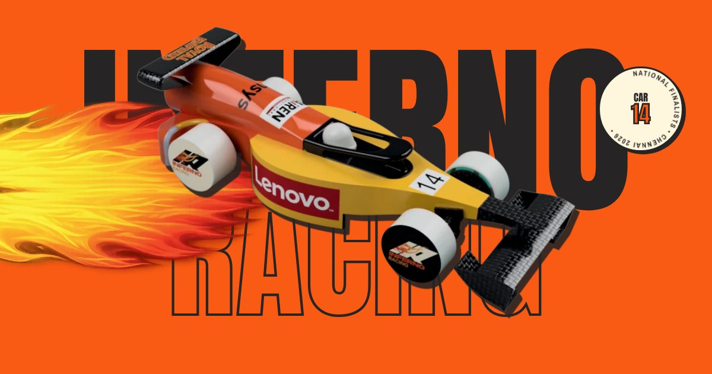

<div align="center">



# Inferno Racing

### Design. Develop. Dominate.

**Team IR-11 · STEM Racing India, Season 08 · The Shishukunj International School, Indore**

[](https://infero-racing.vercel.app)
[](https://www.instagram.com/infernoracingofficial/)

</div>

---

## 🏆 Results

| Award | Event |
|:------|:------|
| 🥇 **Best Verbal Presentation** | National Finals, Chennai, 9 Aug 2026 |
| 🏁 **4th Fastest Car in India** | National Finals, Chennai, 9 Aug 2026 |
| 🔬 **Best R&D** | National Qualifier (Regionals), 3 Apr 2026 |

---

## 📑 Contents

1. [About the team](#-about-the-team)
2. [The car: IR-11](#-the-car-ir-11)
3. [Engineering highlights](#-engineering-highlights)
4. [Enterprise](#-enterprise)
5. [Team](#-team)
6. [The website](#-the-website)
7. [Run it locally](#-run-it-locally)
8. [Project structure](#-project-structure)
9. [Deployment](#-deployment)
10. [Portfolios](#-portfolios)

---

## 🔥 About the team

Inferno Racing is a team of five grade 11 and 12 students from **The Shishukunj International School, Indore**, competing in **STEM Racing India** (formerly F1 in Schools). We treated the competition as a full engineering and enterprise challenge: CAD, CFD and CNC on one side, and sponsorship, budgeting, marketing and project management on the other.

- **The name** comes from The Flash. Not the red suit, but the controlled, analytical speed underneath. Inferno means the same thing to us: heat, energy and power under control.
- **The colours** come from a flame. Orange and yellow are the fire, and black is the soot it leaves behind.

| Black | Orange | Yellow | White |
|:-----:|:------:|:------:|:-----:|
| `#262424` | `#FA5B14` | `#F99527` | `#FFF6DE` |

---

## 🏎️ The car: IR-11

Designed in **Fusion 360**, simulated with **CFD**, and machined on a **CNC** from a single official STEM Racing model block.

| | |
|:--|:--|
| **Total drag** | **0.35 N** in CFD at 22 m/s, down from 0.69 N on our first car (**−49%**) |
| **Mass** | **55.7 g** before the power pack |
| **Nose cone** | Design 3 of 3: 0.15 N drag, safety factor 9.9, the only design fully within regulation T8.7 |
| **Wheels** | V4: moment of inertia cut from 691 to 337 (**−51%**), passing a 50 N load test |
| **Body** | Shark-inspired shape, G1-continuous surfaces verified with zebra analysis |
| **Inspiration** | Shark (body), kingfisher beak (nose profile), 1992 Benetton B192 (high nose), water droplet (rear-wing support) |

<details>
<summary><b>Mass breakdown</b></summary>

| Part | Mass |
|:-----|-----:|
| Car body | 22 g |
| Halo & helmet | 9.5 g |
| Nose cone | 6.34 g |
| Rear wheels (2) | 5 g |
| Front wheels (2) | 4.2 g |
| Rear wing | 3.64 g |
| Rear wheel support | 2.61 g |
| Front wheel support | 2.39 g |
| **Total** | **≈ 55.7 g** |

</details>

---

## 🔬 Engineering highlights

1. **Research:** drag, wheel moment of inertia, tipping moment, rolling resistance and wheel wake.
2. **Design inspiration:** biomimicry and F1 history (shark, kingfisher, Benetton B192).
3. **Car body:** zebra analysis to reach G1 continuity at the nose-to-body and halo-to-body joins.
4. **Nose cone:** three designs tested in FEA and CFD; Design 3 had the lowest drag and was the only one fully within regulation T8.7, so it went on the nationals car.
5. **Rear wing:** V1 had a safety factor of 7.8 and V2 18.2, far more material than needed, so V3 was thinned to 1.48 against a 1.5 target.
6. **Wheels:** four iterations to cut inertia while staying rigid.
7. **CNC:** three setups (top, bottom and side milling) with a 3 mm ball-nose end mill, about 3 h 35 min of toolpaths.
8. **Testing:** full-car CFD and streamlines, then vernier calliper checks, a 200 g tether-guide pull test and a 3° incline roll test.

We also built **Lights Out**, a start-light reaction trainer that the whole team used to practise race starts. A playable version is on the website.

---

## 💼 Enterprise

**₹75,000 raised from 11 partners**, against a deliberately lean **₹30,000** build budget.

| Tier | Partners |
|:-----|:---------|
| **Principal** (₹15,000 each) | Royal Enfield, Lenovo |
| **Monetary** (₹10,000 each) | The Shishukunj International School, Airen International, Chopada Motors |
| **Aid** (₹5,000 each) | Balaji Group, Tekzee Technologies, Zevar by Sethis |
| **Analysis partner** (in kind) | Ansys |
| **Sustainability partner** (in kind) | Raah Foundation |
| **Food & beverages** (in kind) | Shri Agrawal Sweets & Namkeen |

- **Reach:** about 28,000 accounts reached in 30 days from 20 Instagram posts (target: 10,000). 51.1% of the audience are women.
- **Sustainability:** with Raah Foundation, about 50 trees planted, about 200 items donated and about 40 volunteer hours. Designing in CFD first saved two physical car prototypes.

---

## 👥 Team

| Member | Role |
|:-------|:-----|
| **Anay Mehta** | Design & Manufacturing Engineer: CAD in Fusion 360, design iterations, CAM and CNC toolpaths, overseeing manufacturing, engineering drawings, renders |
| **Yuvraj Nikum** | Marketing Manager: branding, social media, joint owner of planning, budget, portfolios and the verbal presentation |
| **Daksh Firoda** | R&D Engineer: design research, component testing, benchmarking, QA and regulation compliance |
| **Vishesh Dagra** | Computational Analysis Engineer: CFD setup, simulations, wing optimisation |
| **Ansh Agrawal** | Sponsorship Manager: sponsor outreach, proposals, partnerships |

---

## 🌐 The website

A single-page site with scroll-driven animations, built to match our portfolio branding.

- **Start lights intro:** five red lights, then lights out (plays once per visit).
- **Hero:** the car launches off the screen on a flame trail as you scroll.
- **Results:** award cards stamp down onto the page.
- **The car:** scroll to turn the IR-11 through six render angles, with its specs highlighting in sync.
- **Engineering:** a horizontal pit-lane scroll through all eight stages.
- **Drag and drawings:** the drag bar halves as you scroll, and the engineering drawings fan out.
- **Lights Out:** a playable reaction trainer (keyboard, tap or game controller).
- **The season:** a car drives down a race-track timeline from kick-off to the national finals.
- **Partners and team:** tiers slide in, the logo ticker speeds up with your scroll, and team cards deal out like a hand of cards.

It works on phones, and it respects the **reduce motion** accessibility setting.

| Layer | Technology |
|:------|:-----------|
| Markup & styles | HTML, CSS (no build step) |
| Animation | [GSAP 3.12](https://gsap.com/) + ScrollTrigger |
| Smooth scrolling | [Lenis](https://github.com/darkroomengineering/lenis) |
| Fonts | Anton (headings, as in our portfolios), Archivo, Archivo Narrow |
| Hosting | [Vercel](https://vercel.com/) |

All libraries and fonts are stored in `assets/`, so the site has no outside dependencies.

---

## 💻 Run it locally

No build tools are needed.

```bash
git clone https://github.com/AnayMehta976/Infero-Racing.git
cd Infero-Racing
python3 -m http.server 8000
```

Then open <http://localhost:8000>.

---

## 📁 Project structure

```
Infero-Racing/
├── index.html            # The whole page
├── css/
│   └── style.css         # Design tokens, layout, responsive rules
├── js/
│   ├── main.js           # Scroll animations (GSAP, ScrollTrigger, Lenis)
│   └── lights-out.js     # The Lights Out reaction trainer
└── assets/
    ├── img/              # Car renders, team photos, sponsor logos, CFD and CAD images (WebP)
    ├── portfolios/       # Our competition portfolios, drawings and renders (PDF)
    ├── fonts/            # Anton, Archivo, Archivo Narrow (WOFF2)
    └── vendor/           # GSAP, ScrollTrigger, Lenis
```

---

## 🚀 Deployment

The site deploys automatically to **[infero-racing.vercel.app](https://infero-racing.vercel.app)** on every push to `main`. It's a static site, so no build settings are needed.

---

## 📚 Portfolios

Read our full STEM Racing India submissions (also linked at the end of the website):

| Document | Pages |
|:---------|------:|
| [Design & Engineering Portfolio](assets/portfolios/inferno-racing-design-engineering-portfolio.pdf) | 11 |
| [Enterprise Portfolio](assets/portfolios/inferno-racing-enterprise-portfolio.pdf) | 12 |
| [Management Portfolio](assets/portfolios/inferno-racing-management-portfolio.pdf) | 7 |
| [Car Renders](assets/portfolios/inferno-racing-renders.pdf) | 9 |
| [Engineering Drawings](assets/portfolios/inferno-racing-engineering-drawings.pdf) | 9 |

---

<div align="center">

**© 2026 Inferno Racing.** Team photos, renders, drawings and sponsor logos belong to their owners.

</div>
